## Disclaimer

```{=html}
<style type="text/css">
.reveal .slide-logo {
  bottom: 0;
  left: 24px
}

.reveal .slide-number {
  bottom: 10px;
  right: 10px;
  left: auto;
  top: auto;
}

.reveal pre code {
  max-height: 560px;
}
</style>
```

This presentation is for informational purposes only and reflects my personal views and interests. It does not constitute investment advice and is not representative of any current or former employer. The information presented is based on publicly available sources. Nothing here is a recommendation to trade any strategy shown.


## About Me

Managing Director at **Columbia Investment Management Co., LLC**, generalist allocator, lead Data Science and Research. Formerly CIO at **Quantopian**, Global Head of Equities and **Millennium Management LLC**, and Co-Head of Equity Derivatives Trading at **JPMorgan**.

- X/Twitter [@jonathanrlarkin](https://x.com/jonathanrlarkin)
- LinkedIn [linkedin.com/in/quantfinance](https://linkedin.com/in/quantfinance)
- Blog: *Speculative Decoding*, [marketneutral.github.io](https://marketneutral.github.io)

. . .

This presentation is available at [github.com/marketneutral/find_alpha_make_no_mistakes](https://github.com/marketneutral/find_alpha_make_no_mistakes).

## The Plan

Can an AI agent do quantitative research without fooling itself?

::: {.incremental}
1. **qex**: a small language for alphas, so a hypothesis is one line
2. **autoresearch**: an agent that proposes, tests, keeps or discards
3. **"find alpha. make no mistakes."**: the loop rebuilt for finance, and run once on data it never saw
:::


# qex

## What is an alpha? {.smaller}

::: {.incremental}
- A forecast $s_{i,t}$ for every stock $i$ on every day $t$, turned into a dollar-neutral book:
$$
w_{i,t} = \frac{s_{i,t} - \bar{s}_t}{\sum_j \lvert s_{j,t} - \bar{s}_t \rvert}, \qquad \sum_i w_{i,t} = 0, \qquad \sum_i \lvert w_{i,t} \rvert = 1
$$
- P&L on gross market value: $r^{p}_{t+1} = \sum_i w_{i,t}\, r_{i,t+1}$
- Why cross-sectional? Grinold's **Fundamental Law of Active Management**:
$$
IR \approx IC \times \sqrt{BR}
$$
- Each forecast carries little skill ($IC$ of a few percent), so breadth $BR$ does the work
:::

## A one-line alpha

```qex
rank(-returns(20) / volatility(60))
```

::: {.incremental}
- Rank stocks by risk-adjusted one-month return, and bet against the winners: a mean-reversion alpha
- The equivalent pandas is ~50 lines of rolling windows, axis arguments, and NaN handling
- The style of Kakushadze's *101 Formulaic Alphas* (2016)
- Open source: [github.com/marketneutral/alpha-parser](https://github.com/marketneutral/alpha-parser)
:::

## From a belief to a line {.smaller}

The shortest path from "I think markets behave like this" to code that tests it:

```qex
# Stocks that fell last week bounce back.
rank(-returns(5))

# ...relative to their sector,
group_demean(rank(-returns(5)), 'sector')

# ...measured in units of how much the stock usually moves,
group_demean(rank(-returns(5) / volatility(60)), 'sector')

# ...and I do not want to trade every wiggle.
decay_linear(group_demean(rank(-returns(5) / volatility(60)), 'sector'), 10)
```

Each clause is one operator. No loops, no index alignment, no `axis=`, no warmup, no NaN handling, no peeking at tomorrow: none of it is the belief, and all of it is where the bugs live.

## Why a language? {.smaller}

::: {.incremental}
- **The expression is the hypothesis, not the implementation.** Everything else is engine, written once.
- **A closed vocabulary makes generated work checkable.** Every well-formed expression is aligned, warmup-aware, and lookahead-free. The only thing it can be wrong about is the idea.
- **Terse is cheap for models.** Tens of tokens instead of thousands.
- **Alphas become data.** Stored, diffed, deduplicated, searched, evolved.
- **The grammar is a search space.** Finite and well-shaped; neighbors are one operator or window away.
- **Review is constant time.** The only kind of review that scales to machine-generated research.
:::

## Three axes: the data {.smaller}

Tickers across the columns, dates down the rows. Real closes, March 2025:

| close() | AAPL | MSFT | XOM | CVX | JPM |
|---|---:|---:|---:|---:|---:|
| Mar 3 | 238.03 | 388.49 | 107.76 | **153.09** | 260.62 |
| Mar 4 | 235.93 | 388.61 | 107.54 | **152.00** | 250.25 |
| Mar 5 | 235.74 | 401.02 | 105.44 | **150.81** | 251.53 |
| Mar 6 | 235.33 | 396.89 | 107.62 | 152.95 | 246.54 |
| Mar 7 | 239.07 | 393.31 | 109.02 | 156.34 | 242.28 |
| Mar 10 | 227.48 | 380.16 | 111.80 | 157.57 | 232.22 |

Every operator works down the columns (**time series**), across the rows (**cross-sectional**), or across the rows within a bucket (**group**).

## Time series: down each column {.smaller}

```qex
ts_mean(close(), 3)
```

| ts_mean(close(), 3) | AAPL | MSFT | XOM | CVX | JPM |
|---|---:|---:|---:|---:|---:|
| Mar 3 | – | – | – | – | – |
| Mar 4 | – | – | – | – | – |
| Mar 5 | 236.57 | 392.71 | 106.91 | **151.97** | 254.13 |
| Mar 6 | 235.67 | 395.51 | 106.87 | 151.92 | 249.44 |
| Mar 7 | 236.71 | 397.07 | 107.36 | 153.37 | 246.78 |
| Mar 10 | 233.96 | 390.12 | 109.48 | 155.62 | 240.35 |

CVX on March 5: $(153.09 + 152.00 + 150.81)/3 = 151.97$. No other stock enters. The first two rows are warmup, and warmup is the engine's job.

## Cross-sectional: across each row {.smaller}

```qex
rank(returns(1))
```

::: {.columns style="font-size: 0.78em;"}
::: {.column width="50%"}
| ret % | AAPL | MSFT | XOM | CVX | JPM |
|---|---:|---:|---:|---:|---:|
| 3/4 | −0.88 | +0.03 | −0.20 | −0.71 | −3.98 |
| 3/5 | −0.08 | +3.19 | −1.95 | −0.78 | +0.51 |
| 3/6 | −0.17 | −1.03 | +2.07 | +1.42 | −1.98 |
| 3/7 | +1.59 | −0.90 | +1.30 | +2.22 | −1.73 |
| 3/10 | **−4.85** | **−3.34** | **+2.55** | **+0.79** | **−4.15** |
:::
::: {.column width="50%"}
| rank | AAPL | MSFT | XOM | CVX | JPM |
|---|---:|---:|---:|---:|---:|
| 3/4 | 0.4 | 1.0 | 0.8 | 0.6 | 0.2 |
| 3/5 | 0.6 | 1.0 | 0.2 | 0.4 | 0.8 |
| 3/6 | 0.6 | 0.4 | 1.0 | 0.8 | 0.2 |
| 3/7 | 0.8 | 0.4 | 0.6 | 1.0 | 0.2 |
| 3/10 | **0.2** | **0.6** | **1.0** | **0.8** | **0.4** |
:::
:::

`rank` returns each stock's percentile within the day, 0 to 1: with five stocks, 0.2 to 1.0. March 10 was a tech sell-off: AAPL worst (0.2), XOM best (1.0). A rank keeps the order and throws away the size, so one outlier cannot dominate.

## Group: across the row, within a bucket {.smaller}

```qex
group_demean(returns(1), 'sector')
```

| group_demean(…), % | AAPL | MSFT | XOM | CVX | JPM |
|---|---:|---:|---:|---:|---:|
| Mar 4 | −0.46 | +0.46 | +0.25 | −0.25 | 0.00 |
| Mar 5 | −1.64 | +1.64 | −0.58 | +0.58 | 0.00 |
| Mar 6 | +0.43 | −0.43 | +0.32 | −0.32 | 0.00 |
| Mar 7 | +1.25 | −1.25 | −0.46 | +0.46 | 0.00 |
| Mar 10 | **−0.75** | **+0.75** | **+0.88** | **−0.88** | **0.00** |

AAPL and MSFT are Technology, XOM and CVX Energy, JPM Financials. March 10: Technology −4.10% on average, so AAPL (−4.85%) is −0.75% against its sector. JPM, alone in its sector, is always zero. What is left is each stock against its peers.

## From a signal to a book {.smaller}

```qex
scale(demean(rank(returns(1))))
```

::: columns
::: {.column width="50%"}
| March 10 | rank | demean | weight |
|---|---:|---:|---:|
| AAPL | 0.2 | −0.4 | −0.333 |
| MSFT | 0.6 | 0.0 | 0.000 |
| XOM | 1.0 | +0.4 | +0.333 |
| CVX | 0.8 | +0.2 | +0.167 |
| JPM | 0.4 | −0.2 | −0.167 |
| sum | 3.0 | **0.0** | **0.000** |
| sum of abs | 3.0 | 1.2 | **1.000** |
:::
::: {.column width="50%"}
::: {.incremental}
- `demean` subtracts the day's average rank (0.6): the weights sum to zero, **dollar-neutral**
- `scale` divides by the sum of absolute values (1.2): **gross of one**
- 50 cents long, 50 cents short per dollar of gross
- `group_demean(…, 'sector')` instead: sector-neutral too
- Returns "on GMV" are per dollar of exactly this book
:::
:::
:::

## Lazy trees, no lookahead, shared work {.smaller}

::: columns
::: {.column width="45%"}
::: {.incremental}
- Parsing builds a tree; nothing is computed until `evaluate(data)`
- **Every operation looks backward.** `delay(x, -1)` is an error, not a too-good backtest.
- Event-aware operators for sparse data (earnings): roll over the last *N observations*, not *N days*
- A set of signals is one graph; each unique sub-expression is computed once
:::
:::
::: {.column width="55%"}
{width="100%"}
:::
:::

## Example: reversal, technician-style {.smaller}

::: columns
::: {.column width="58%"}
```qex
let lo   = ts_min(low(), 5),
    hi   = ts_max(high(), 5),
    pos  = (close() - lo) / (hi - lo),
    book = group_demean(rank(-pos), 'sector')
in scale(decay_linear(book, 10))
```

::: {.incremental}
- `pos`: where the close sits in its five-day range, 0 at the low, 1 at the high; rank `-pos` buys closes near the low
- Jegadeesh (1990), Lehmann (1990): last week's losers beat last week's winners
- Nagel (2012): reversal is pay for providing liquidity
- Khandani and Lo (2007): *the* stat arb strategy of August 2007
- Technicians call it *Williams %R*; it works once you think cross-sectionally
:::
:::
::: {.column width="42%"}
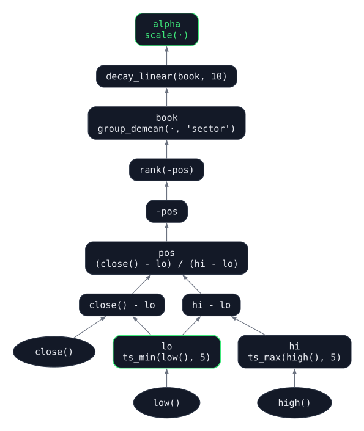{width="100%"}
:::
:::

## Does it sort returns?

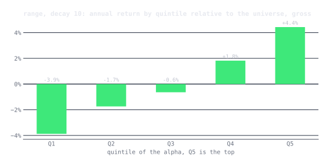{width="85%"}

S&P 500 members (survivorship-biased!), 2010-2025, gross of costs. Monotonic quintiles; top-minus-bottom 8.3%/yr.

## Smoothing is (almost) a free lunch {.smaller}

| Range, daily | Turnover / day | Gross on GMV | Gross Sharpe | Net at 2 bps | Net Sharpe | Max DD |
|---|---:|---:|---:|---:|---:|---:|
| no smoothing | 84% | +3.8% | 0.98 | −0.5% | −0.13 | −21% |
| **decay 10** | **32%** | **+3.8%** | **0.90** | **+2.2%** | **0.52** | **−15%** |

. . .

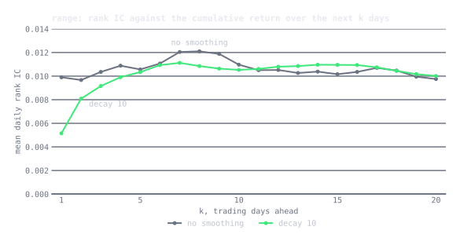{width="70%"}

The signal's horizon is ~2 weeks, so a 10-day decay keeps the forecast and drops the noise.

## qex takeaways

::: {.incremental}
- The expression is the hypothesis; the engine guarantees alignment and no lookahead
- A closed grammar is a search space with no invalid points
- Which is exactly what an agent needs to search in
:::


# autoresearch

## Science is a loop

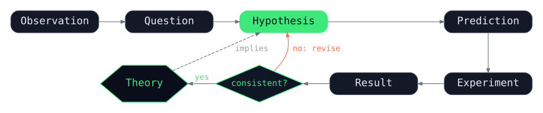{width="75%"}

The highlighted step, proposing the hypothesis, has always needed a person.

## When there is a slope

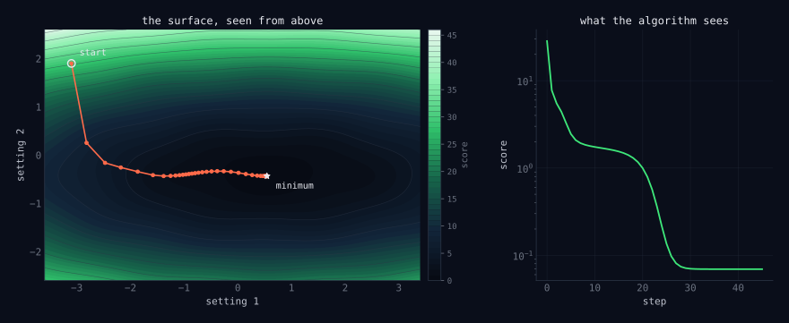{width="90%"}

If the hypothesis is a vector $\theta$ and the score is smooth, $\theta_{k+1} = \theta_k - \eta \nabla L(\theta_k)$. Nobody decides what to try next.

## "There is no slope." {.smaller}

::: {.incremental}
- Most hypotheses are programs, protocols, features, molecules: discrete, and each test is expensive
- The old options: random or grid search, evolutionary search, Bayesian optimization. All need the hypothesis to be a vector, and none knows anything about the problem.
- A language model is a third option: it has read the field's code and papers, so its guesses are *informed*, and it makes one every few minutes
- FunSearch (2024), AlphaEvolve (2025): LLM proposals against an automatic evaluator found new mathematics
:::

## Karpathy's autoresearch (March 2026) {.smaller}

::: columns
::: {.column width="40%"}
::: {.incremental}
- `program.md`: the problem, written by a person
- `train.py`: the only file the agent may edit
- `prepare.py`: data and test, out of reach
- Every trial: 5 minutes; keep if `val_bpb` improves, else `git reset`
:::
:::
::: {.column width="60%"}
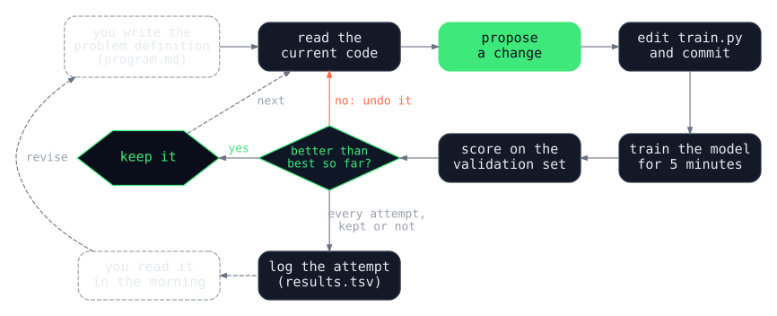{width="100%"}
:::
:::

## One overnight run

{width="85%"}

14 of 82 changes kept. Note the last kept change, in red: **a new random seed**.

## It works on anything with a score {.smaller}

| what the agent edits | how it is scored | one trial |
|---|---|---|
| a training script | validation loss | five minutes on a GPU |
| a template engine (Shopify Liquid) | speed and memory, all tests passing | the benchmark suite |
| features for a materials model | error on held-out compounds | one model fit |
| a prompt or a skill | accuracy on held-out examples | a batch of model calls |

. . .

Liquid: ~120 experiments, 93 kept commits, parse and render time −53%, allocations −61%, all 974 tests passing.

## What it means for finance {.smaller}

::: {.incremental}
- The obvious mapping: the artifact is signal code, the score is a backtest Sharpe on a hold-out, keep if it goes up
- That is the one thing quant finance spent decades learning not to do
- Wiecki et al. (2016), *All that Glitters Is Not Gold*: 888 Quantopian strategies with 6+ months live. Backtest Sharpe explained almost none of live performance, $R^2 < 0.025$
- **Hill-climbing on a hold-out leaks it into the strategy, one keep at a time**
- A hold-out is one draw of history; a win may only be a bet on that regime
- The red dot again: a new random seed is not a better model, and the loop kept it
:::

## What would have to change {.smaller}

::: {.incremental}
1. **Require the claim before the test**: mechanism, counterparty, persistence, and a prediction of *where* it helps
2. **Make the evaluator move**: purged, randomized cross-validation; keep only if the median fold improves and the worst does not fall
3. **Charge for complexity**: fit minus a charge per parameter, AIC in spirit
4. **Count the trials**: deflate the winner's Sharpe (Bailey and López de Prado 2014)
5. **Seed the search** with the firm's own view
6. **Measure the consensus**: McLean and Pontiff (2016), predictor returns −58% after publication
7. **Keep one period the loop never touches**, and use it once
:::


# "find alpha. make no mistakes."

## The experiment {.smaller}

::: {.incremental}
- **The agent:** Claude Code, headless, one session, 60 trials, 55 minutes, ~$20
- **The artifact:** one qex expression, `alpha.qex`
- **The seed:** textbook momentum that *loses money* on the scored period
- **The problem:** keep the momentum premium, avoid the crashes (Daniel and Moskowitz 2016)
- **The beliefs:** twelve, each with mechanism, counterparty, paper, and a falsifiable prediction; every paper predates the test period
- **The periods:**
  - inspection 1999-2003: the agent may look
  - validation 2004-2017: the agent sees only summary numbers
  - test 2018 to Aug 2026: sealed; I ran it once, after trial 60
:::

## The result first

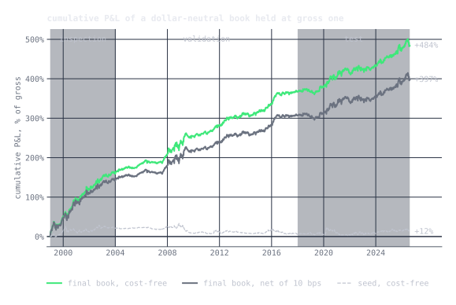{width="85%"}

Seed: −1%/yr on validation. Final: 13%/yr at Sharpe 1.08 on validation, **13.5%/yr at Sharpe 0.76 on the sealed test**.

## Data and book {.smaller}

::: {.incremental}
- **Point-in-time, survivorship-free:** every US common stock that traded, ~8,600 names, delisted and bankrupt names priced to their last trade. Universe each day: close ≥ \$2, ADV ≥ \$5M, market cap ≥ \$300M, from that day's facts only.
- **Book construction**, the same for every expression: demean, scale to $\sum_i \lvert w_i \rvert = 1$, cap $\lvert w_i \rvert \le 5\%$, iterate until all three hold
- **Delay 1:** signal from data through the close of $t$, traded at the close of $t+1$
- The agent chooses *which* stocks get weight, never how big the book is
:::

## The seed

```qex
let mom   = delay(returns(231), 21),
    vol   = volatility(60),
    score = group_demean(mom / vol, 'sector')
in decay_linear(score / vol, 10)
```

::: {.incremental}
- 12-1 momentum, sector-relative, volatility-scaled, inverse-vol sized, smoothed
- Validation Sharpe −0.25; **−1.96 in the crash state**
- Loses 8 bps per dollar traded, before costs
:::

## The score {.smaller}

Per fold, on cost-free P&L:

$$
\text{utility} = \underbrace{\text{Sharpe} \times \sqrt{\frac{\lvert \text{annual return} \rvert}{\max(\text{turnover},\ 0.125)}}}_{\text{fitness}} \; - \; 0.003 \times \text{nodes}
$$

::: {.incremental}
- 2004-2017 cut into 12 blocks (~14 months), dealt at random into 6 folds, 21-day embargo at block edges
- Each call: **50 random deals**; report the mean over deals of the **median fold** and of the **worst fold**
- Median fold: no single stretch carries the score. Worst fold: the crash guard. Fresh deals: no fixed hold-out to please. 50 deals: a good score is not the luck of one cut.
- **Eligible:** turnover in 1-70%/day, margin ≥ 5 bps per dollar traded
:::

## The keep rule {.smaller}

A change is kept only if

1. median-fold utility rises by more than **0.03** (noise, measured by scoring the seed 8 times)
2. worst-fold utility falls by no more than **0.13** (its own noise)
3. the book stays **eligible**

. . .

Otherwise `git checkout <best> -- alpha.qex`, and log the attempt either way.

## Counting the trials {.smaller}

Every trial prints the **deflated Sharpe ratio** of Bailey and López de Prado (2014), the probability the Sharpe is real given $N$ strategies tried:

$$
\widehat{PSR}(SR_0) = \Phi\!\left(\frac{(\widehat{SR} - SR_0)\sqrt{T-1}}{\sqrt{1 - \hat\gamma_3 \widehat{SR} + \frac{\hat\gamma_4 - 1}{4}\widehat{SR}^2}}\right)
$$

$$
SR_0 = \sqrt{\mathbb{V}[\widehat{SR}_n]}\left((1-\gamma)\,\Phi^{-1}\!\left(1-\tfrac{1}{N}\right) + \gamma\,\Phi^{-1}\!\left(1-\tfrac{1}{N e}\right)\right)
$$

$N$ = rows in the notebook so far, $\gamma$ the Euler-Mascheroni constant, $\hat\gamma_3, \hat\gamma_4$ the skew and kurtosis of daily P&L, $\mathbb{V}[\widehat{SR}_n]$ the variance of the trials' Sharpe ratios. The final book: **0.974** after 61 rows. It informs the agent; it does not decide keeps.

## The augmented loop

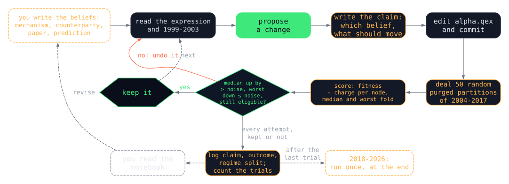{width="100%"}

What the agent sees after each trial: score, worst fold, eligibility, whole-period Sharpe/return/turnover/margin, one deal's six folds with their years, regime splits, the deflated Sharpe. **Never a price.**

## The run

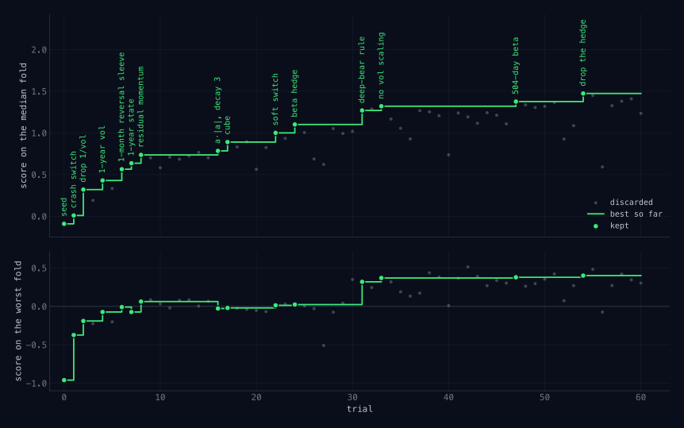{width="90%"}

60 trials, 14 kept. Median-fold utility −0.09 → 1.47; worst fold −0.96 → +0.40.

## Acts 1 and 2: fix the obvious, build the engine {.smaller}

::: {.incremental}
- **T1, crash switch** (belief 7): flip momentum when the market is down over 2y and 1m vol > 1y vol. Crash-state Sharpe −1.96 → +3.32.
- **T2, delete a line**: the seed divided by vol twice ($w \propto m/\sigma^2$). One deletion and the book is eligible.
- **T6, a 1-month reversal sleeve**: fitness does not charge turnover below 12.5%/day, so a fast sleeve rides free
- **T8, residual momentum** (Blitz, Huij, Martens 2011): rank on $r_{i,t} - \hat\beta_i\, r_{m,t}$. Predicted the worst fold would gain more than the median; it did.
- **T14-17, concentration**, the agent's own idea: signed square, then a **cube**
:::

## The cube {.smaller}

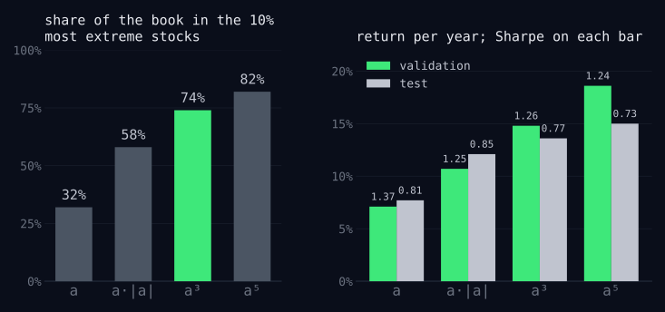{width="85%"}

::: {.incremental}
- Gross is fixed, so magnitude only allocates the dollar; cubing keeps the ranking and moves weight to the tails
- Same Sharpe, **twice the return** per dollar of gross, in sample and out
- Emergent, and a rediscovery of Almgren and Chriss, *Portfolios from Sorts* (2006): optimal weights from a ranking are flat in the middle, steep at the ends; return is convex in the signal
:::

## Act 3: the crash argument {.smaller}

::: {.incremental}
- **T22, soft switch:** momentum weight $w = \text{clip}(10 \cdot r^{1y}_m, -1, 1)$ when turbulent. The belief predicted it would help less; it beat the hard switch on both numbers.
- **T24, beta hedge** (Grundy and Martin 2001): the crash is a market event, so hedge the market. Kept.
- **T27: is the switch still needed?** The agent asked, and wrote down in advance what would settle it.
:::

## Trial 27, as the agent saw it {.smaller}

**Claim:** *Remove the crash switch now that the book is beta-hedged. Grundy-Martin: hedging factor exposure removes most momentum crash risk... if worst falls >0.13, belief 7 still earns its keep.*

```
utility: 0.622
worst:   -0.510
  fold 0: utility -0.349  fitness -0.26  Sharpe -0.48  return/yr  -3.6%  ...  years 2009-2011
           crash state      Sharpe -1.53 return/yr -15.1% (137 days);  calm Sharpe  0.78 return/yr  +4.3%
```

**Outcome:** *Belief 7 strongly confirmed: residual momentum in a beta-neutral book still crashes; the crash is the stock-specific losers rebounding, not beta. Reset.*

## The deep-bear rule {.smaller}

::: {.incremental}
- The switch acts only when 1m vol > 1y vol. But a vol spike inflates the 1y number, so the switch turns off **while the market is still deep in its hole and the losers are still rallying**. That is 2009.
- T30: a depth rule for calm markets: shrink momentum below −10% on the year, reverse below −20%. Worst fold 0.02 → 0.35; median fell. Reset.
- T31: both rules. The vol rule earns the median, the depth rule saves the rebound. Worst fold 0.02 → 0.32, kept.
- **Act 4, prune:** remove vol scaling (return 8% → 13%); remove the agent's own hedge (+0.10: the 504-day residual had already removed the beta)
:::

## What it built

```qex
let r     = returns(1),
    mk    = r - demean(r),
    m1    = ts_sum(mk, 252),
    w     = where(ts_std(mk, 21) > ts_std(mk, 252),
                  max(min(10 * m1, 1), -1),
                  max(min(10 * m1 + 1, 1), -1)),
    b     = ts_beta(returns(1), mk, 504),
    rr    = returns(1) - b * mk,
    mom   = delay(ts_sum(rr, 231), 21),
    score = group_demean(mom, 'sector'),
    a     = decay_linear(w * score, 10)
            - group_demean(returns(21), 'sector')
in decay_linear(power(a, 3), 3)
```

Residual momentum under a market-state switch, plus a sector reversal sleeve, cubed. 32 nodes.

## Did it hold up? {.smaller}

| | period | Sharpe | return / yr | net of 10 bps | max drawdown |
|---|---|---:|---:|---:|---:|
| seed | validation | −0.23 | −1.0% | −2.3% | −27% |
| seed | **test** | 0.12 | +0.9% | −0.4% | −19% |
| final | validation | 1.08 | +12.9% | +9.9% | −24% |
| final | **test** | **0.76** | **+13.5%** | **+10.5%** | −27% |

. . .

Validation 2004-2017, test 2018 to Aug 2026. The return held; volatility rose (12% → 18%), so Sharpe fell by a third. The seed earned nothing over the same years.

## Decay, or noise? {.smaller}

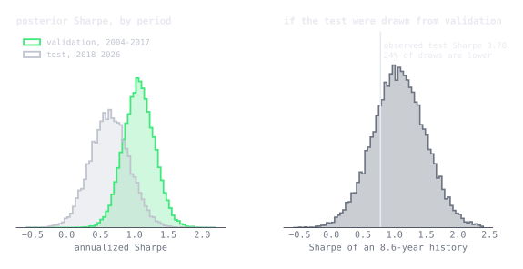{width="85%"}

BEST (Kruschke 2013) on weekly P&L: $y_{p,t} \sim t_\nu(\mu_p, \sigma_p)$, $p \in \{\text{val}, \text{test}\}$. Posterior predictive: **41%** of 8.6-year histories drawn from the validation posterior have Sharpe ≤ the observed 0.74. $P(SR_{test} > 0) = 0.97$.

## The crash switch, out of sample

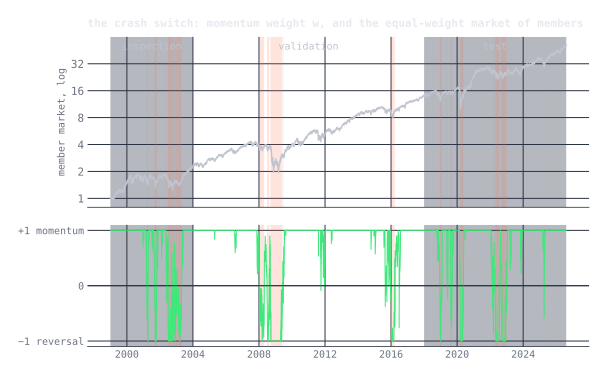{width="80%"}

2009 junk rally (Mar-Jun): seed −13.6%, final **+14.6%**. No test-period bear market cost more than 6%.

## The drawdown it did not see {.smaller}

::: {.incremental}
- Mid-June to late July 2026: **−27% in six weeks**, unrecovered at the end of the data
- The switch sat at full momentum: the market was calm and up on the year
- The loss was on the **long** side: last year's winners unwinding (−20% longs, −5% shorts; one name at the 5% cap cost 5%)
- Daniel-Moskowitz crashes are losers rebounding after a fall; a winners' unwind in a calm market is a different event
- The cube makes it worse: ~1,500 names held, but an effective $N = 1/\sum_i w_i^2 \approx 100$
:::

## What I learned {.smaller}

::: {.incremental}
- **The written claims were the most valuable output.** Most resets were predicted; the wrong predictions came with explanations.
- **Measure the noise at the top, not just at the start.** Seed noise ±0.02; the same book written two ways scored 0.058 apart at utility ~1.4.
- **The keep rule cannot accept a pure worst-case improvement**, a strange blind spot for a crash problem
- **The loop finds a local optimum, and which one depends on its path.** The hedge paid at T24 and paid again when removed at T54. Beam search or MCTS would buy breadth with trials, and need the trial count to stay honest.
- **The inspection period was right about structure, wrong about risk.** T40: +0.3 Sharpe on 1999-2003, nearly halved the score on 2004-2017.
:::

## Conclusions {.smaller}

::: {.incremental}
- A closed language (qex) makes an alpha a hypothesis an agent can propose and a machine can check
- An autoresearch loop will find noise in a backtest unless the evaluator is rebuilt: claims, moving folds, complexity charge, trial counts, a sealed period
- Rebuilt, it took a losing textbook strategy to one that held up on 8.5 unseen years, and it argued with evidence about *why*
- The model has read the news through 2026; no held-out period closes that leak
- **The only test clean of all of it is the one that starts today, live**
:::

## References: qex

::: {.refs}
- Doherty, K. "More Risk, Less Speed: Hudson River Mints Billions Slowing Down." *Bloomberg*, December 2025.
- Grinold, R. C. "The Fundamental Law of Active Management." *Journal of Portfolio Management* 15(3), 1989.
- Grinold, R. C. and Kahn, R. N. *Active Portfolio Management*, 2nd ed. McGraw-Hill, 2000.
- Jegadeesh, N. "Evidence of Predictable Behavior of Security Returns." *Journal of Finance* 45(3), 1990.
- Kakushadze, Z. "101 Formulaic Alphas." *Wilmott* 2016(84), 2016.
- Khandani, A. E. and Lo, A. W. "What Happened to the Quants in August 2007?" *Journal of Investment Management* 5(4), 2007.
- Larkin, J. *qex: a domain-specific language for quant alphas.* [github.com/marketneutral/alpha-parser](https://github.com/marketneutral/alpha-parser)
- Lehmann, B. N. "Fads, Martingales, and Market Efficiency." *Quarterly Journal of Economics* 105(1), 1990.
- Nagel, S. "Evaporating Liquidity." *Review of Financial Studies* 25(7), 2012.
- Tulchinsky, I. et al. *Finding Alphas: A Quantitative Approach to Building Trading Strategies*, 2nd ed. Wiley, 2019.
- Blog post: [qex: a small language for quant alphas](https://marketneutral.github.io/posts/qex/)
:::

## References: autoresearch

::: {.refs}
- Karpathy, A. [autoresearch](https://github.com/karpathy/autoresearch), including `program.md`, 2026.
- Shopify/liquid [#2056](https://github.com/Shopify/liquid/pull/2056): the Liquid result, benchmark table and methodology.
- Cobelli and Sanvito. "Agentic Design of Compositional Descriptors via Autoresearch for Materials Science Applications." arXiv 2605.14671, 2026.
- Anthropic. [`skill-creator`](https://github.com/anthropics/skills/blob/main/skills/skill-creator/SKILL.md), including `scripts/run_loop`.
- McLean, R. D. and Pontiff, J. "Does Academic Research Destroy Stock Return Predictability?" *Journal of Finance* 71(1), 2016.
- Wiecki, T., Campbell, A., Lent, J. and Stauth, J. "All that Glitters Is Not Gold." SSRN, 2016.
- Sutton, R. "The Bitter Lesson." 2019.
- Bailey, D. H. and López de Prado, M. "The Deflated Sharpe Ratio." *Journal of Portfolio Management* 40(5), 2014.
- López de Prado, M. *Advances in Financial Machine Learning.* Wiley, 2018.
- Rolnick, D., Veit, A., Belongie, S. and Shavit, N. "Deep Learning is Robust to Massive Label Noise." 2017.
- Romera-Paredes, B. et al. "Mathematical Discoveries from Program Search with Large Language Models." *Nature*, 2024.
- DeepMind. "AlphaEvolve: A Gemini-Powered Coding Agent for Designing Advanced Algorithms." 2025.
- Blog post: [autoresearch: sparks of an AI scientist](https://marketneutral.github.io/posts/ai-scientist/)
:::

## References: "find alpha"

::: {.refs}
- Almgren, R. and Chriss, N. "Optimal Portfolios from Ordering Information." *Journal of Risk* 9(1), 2006. Circulated as "Portfolios from Sorts."
- Barroso, P. and Santa-Clara, P. "Momentum Has Its Moments." *Journal of Financial Economics* 116(1), 2015.
- Blitz, D., Huij, J. and Martens, M. "Residual Momentum." *Journal of Empirical Finance* 18(3), 2011.
- Chordia, T., Roll, R. and Subrahmanyam, A. "Liquidity and Market Efficiency." *Journal of Financial Economics* 87(2), 2008.
- Da, Z., Gurun, U. G. and Warachka, M. "Frog in the Pan: Continuous Information and Momentum." *Review of Financial Studies* 27(7), 2014.
- Daniel, K. and Moskowitz, T. J. "Momentum Crashes." *Journal of Financial Economics* 122(2), 2016.
- George, T. J. and Hwang, C.-Y. "The 52-Week High and Momentum Investing." *Journal of Finance* 59(5), 2004.
- Grundy, B. D. and Martin, J. S. "Understanding the Nature of the Risks and the Source of the Rewards to Momentum Investing." *Review of Financial Studies* 14(1), 2001.
- Jegadeesh, N. and Titman, S. "Returns to Buying Winners and Selling Losers." *Journal of Finance* 48(1), 1993.
- Kruschke, J. K. "Bayesian Estimation Supersedes the t Test." *Journal of Experimental Psychology: General* 142(2), 2013.
- Novy-Marx, R. "Is Momentum Really Momentum?" *Journal of Financial Economics* 103(3), 2012.
- Also cited above: Bailey and López de Prado (2014), Karpathy (2026), Nagel (2012).
- Blog post: ["find alpha. make no mistakes."](https://marketneutral.github.io/posts/autoresearch-alpha/)
:::

## Thank You!

- Questions? Comments?
