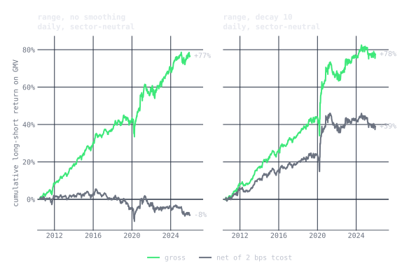
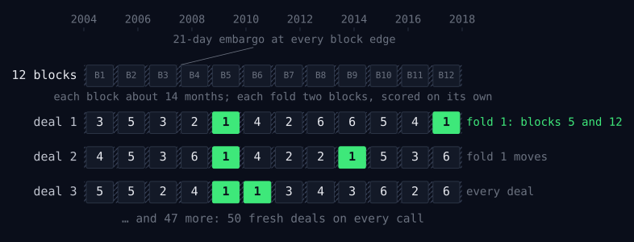
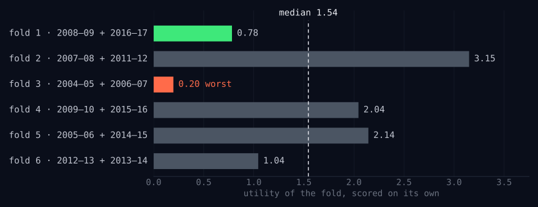
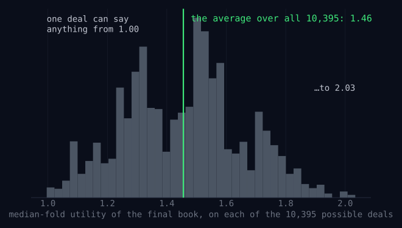
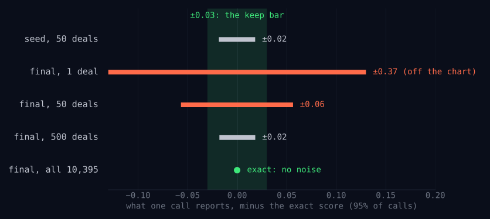
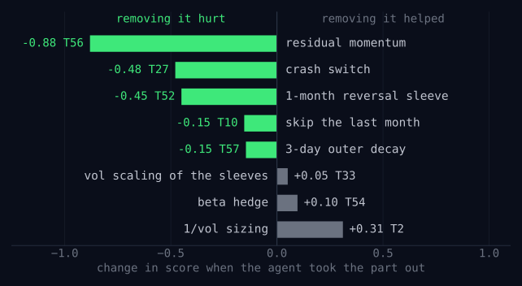

## Disclaimer

```{=html}
<style type="text/css">
.reveal .slide-logo {
  bottom: 0;
  left: 24px
}

.reveal .slide-number {
  bottom: 10px;
  right: 10px;
  left: auto;
  top: auto;
}

.reveal pre code {
  max-height: 560px;
}
</style>
```

This presentation is for informational purposes only and reflects my personal views and interests. It does not constitute investment advice and is not representative of any current or former employer. The information presented is based on publicly available sources. Nothing here is a recommendation to trade any strategy shown.


## About Me

Managing Director at **Columbia Investment Management Co., LLC**, generalist allocator, lead Data Science and Research. Formerly CIO at **Quantopian**, Global Head of Equities at **Millennium Management LLC**, and Co-Head of Equity Derivatives Trading at **JPMorgan**.

- X/Twitter [@jonathanrlarkin](https://x.com/jonathanrlarkin)
- LinkedIn [linkedin.com/in/quantfinance](https://linkedin.com/in/quantfinance)
- Blog: *Speculative Decoding*, [marketneutral.github.io](https://marketneutral.github.io)

. . .

This presentation is available at [github.com/marketneutral/find_alpha_make_no_mistakes](https://github.com/marketneutral/find_alpha_make_no_mistakes).

## The Plan

Can an AI agent do real quant research? Can an agent find alpha that persists out-of-sample?

::: {.incremental}
1. **qex**: a small language for alphas
2. **autoresearch**: Karpathy's loop for the scientific method
3. **"find alpha. make no mistakes."**: the loop adjusted for finance
:::


# qex

## The idea

Every alpha starts as a stated belief about markets:

> *"Stocks that fell last week tend to bounce back."*

::: {.incremental}
- Testing it the usual way is a hodgepodge of pandas: rolling windows, index alignment, `axis=` arguments, warmup, missing data, and the care not to peek at tomorrow
- Nothing about the idea; all potential bugs
- **qex: the shortest path from "I think markets behave like this" to code that tests it**
:::

## A one-line alpha

> *"Stocks that fell last week tend to bounce back."*

```qex
rank(-returns(5))
```

::: {.incremental}
- `returns(5)`: each stock's return over the last week
- `-`: the ones that fell score highest
- `rank`: compared across all stocks on each day, 0 to 1
- **That is the whole alpha.** A pandas version adds needless complexity.
:::

::: {.refs}
qex is open source: [github.com/marketneutral/alpha-parser](https://github.com/marketneutral/alpha-parser).
:::

## From a belief to a line {.smaller .ladder}

Refine the belief one clause at a time, and the expression follows:

```qex
# Stocks that fell last week tend to bounce back.
rank(-returns(5))

# ...relative to their sector,
group_demean(rank(-returns(5)), 'sector')

# ...measured in units of how much the stock usually moves,
group_demean(rank(-returns(5) / volatility(60)), 'sector')

# ...and I do not want to trade every wiggle.
decay_linear(group_demean(rank(-returns(5) / volatility(60)),
                          'sector'), 10)
```

Each clause is one operator. No loops, no index alignment, no `axis=`, no warmup, no NaN handling, no peeking at tomorrow: none of it is the belief, and all of it is where the bugs live. Every operator: [the qex operations reference](https://marketneutral.github.io/alpha-parser/reference/operations/).

## Why a language? {.smaller}

::: {.incremental}
- **The expression is the hypothesis, not the implementation.** Everything else is in the engine, written once, highly performant. qex is a DSL specification, and a concrete implementation.
- **A closed vocabulary makes generated work checkable.** Every well-formed expression is aligned, warmup-aware, and lookahead-free. The only thing it can be wrong about is the idea.
- **Terse is cheap for models.** Tens of tokens instead of thousands.
- **Alphas become data.** Stored, diffed, deduplicated, searched, evolved.
- **The grammar is a search space.** Finite and well-shaped; neighbors are one operator or window away.
- **Review is constant time.** The only kind of review that scales to machine-generated research.
- **A small grammar helps mitigate overfitting.** Information theory supports this (more later!)
:::

## Three axes: the data {.smaller}

Tickers across the columns, dates down the rows. Real closes, March 2025:

| close() | AAPL | MSFT | XOM | CVX | JPM |
|---|---:|---:|---:|---:|---:|
| Mar 3 | 238.03 | 388.49 | 107.76 | **153.09** | 260.62 |
| Mar 4 | 235.93 | 388.61 | 107.54 | **152.00** | 250.25 |
| Mar 5 | 235.74 | 401.02 | 105.44 | **150.81** | 251.53 |
| Mar 6 | 235.33 | 396.89 | 107.62 | 152.95 | 246.54 |
| Mar 7 | 239.07 | 393.31 | 109.02 | 156.34 | 242.28 |
| Mar 10 | 227.48 | 380.16 | 111.80 | 157.57 | 232.22 |

*Bold: the three CVX closes averaged on the next slide.* Every operator works down the columns (**time series**), across the rows (**cross-sectional**), or across the rows within a bucket (**group**).

[In this example we use tickers for legibility, but a real system would use permanent identifiers.]{.pq-note}

## Time series: down each column {.smaller}

```qex
ts_mean(close(), 3)
```

| ts_mean(close(), 3) | AAPL | MSFT | XOM | CVX | JPM |
|---|---:|---:|---:|---:|---:|
| Mar 3 | – | – | – | – | – |
| Mar 4 | – | – | – | – | – |
| Mar 5 | 236.57 | 392.71 | 106.91 | **151.97** | 254.13 |
| Mar 6 | 235.67 | 395.51 | 106.87 | 151.92 | 249.44 |
| Mar 7 | 236.71 | 397.07 | 107.36 | 153.37 | 246.78 |
| Mar 10 | 233.96 | 390.12 | 109.48 | 155.62 | 240.35 |

CVX on March 5, the three bold closes from the last slide: $(153.09 + 152.00 + 150.81)/3 = 151.97$. No other stock enters. The first two rows are warmup, and warmup is the engine's job.

## Cross-sectional: across each row {.smaller}

```qex
rank(returns(1))
```

::: {.columns style="font-size: 0.78em;"}
::: {.column width="50%"}
| ret % | AAPL | MSFT | XOM | CVX | JPM |
|---|---:|---:|---:|---:|---:|
| 3/3 | – | – | – | – | – |
| 3/4 | −0.88 | +0.03 | −0.20 | −0.71 | −3.98 |
| 3/5 | −0.08 | +3.19 | −1.95 | −0.78 | +0.51 |
| 3/6 | −0.17 | −1.03 | +2.07 | +1.42 | −1.98 |
| 3/7 | +1.59 | −0.90 | +1.30 | +2.22 | −1.73 |
| 3/10 | **−4.85** | **−3.34** | **+2.55** | **+0.79** | **−4.15** |
:::
::: {.column width="50%"}
| rank | AAPL | MSFT | XOM | CVX | JPM |
|---|---:|---:|---:|---:|---:|
| 3/3 | – | – | – | – | – |
| 3/4 | 0.4 | 1.0 | 0.8 | 0.6 | 0.2 |
| 3/5 | 0.6 | 1.0 | 0.2 | 0.4 | 0.8 |
| 3/6 | 0.6 | 0.4 | 1.0 | 0.8 | 0.2 |
| 3/7 | 0.8 | 0.4 | 0.6 | 1.0 | 0.2 |
| 3/10 | **0.2** | **0.6** | **1.0** | **0.8** | **0.4** |
:::
:::

March 3 is empty: a return needs the previous close. `rank` returns each stock's percentile within the day, 0 to 1: with five stocks, 0.2 to 1.0. March 10 was a tech sell-off: AAPL worst (0.2), XOM best (1.0). A rank keeps the order and throws away the size, so one outlier cannot dominate.

## Group: across the row, within a bucket {.smaller}

```qex
group_demean(returns(1), 'sector')
```

| group_demean(…), % | AAPL | MSFT | XOM | CVX | JPM |
|---|---:|---:|---:|---:|---:|
| Mar 3 | – | – | – | – | – |
| Mar 4 | −0.46 | +0.46 | +0.25 | −0.25 | 0.00 |
| Mar 5 | −1.64 | +1.64 | −0.58 | +0.58 | 0.00 |
| Mar 6 | +0.43 | −0.43 | +0.32 | −0.32 | 0.00 |
| Mar 7 | +1.25 | −1.25 | −0.46 | +0.46 | 0.00 |
| Mar 10 | **−0.75** | **+0.75** | **+0.88** | **−0.88** | **0.00** |

AAPL and MSFT are Technology, XOM and CVX Energy, JPM Financials. March 10: Technology −4.10% on average, so AAPL (−4.85%) is −0.75% against its sector. JPM, alone in its sector, is always zero. What is left is each stock against its peers.

## From a signal to a book {.smaller}

```qex
scale(demean(rank(returns(1))))
```

::: columns
::: {.column width="50%" .book-weights}
| March 10 | rank | demean | weight |
|---|---:|---:|---:|
| AAPL | 0.2 | −0.4 | −0.333 |
| MSFT | 0.6 | 0.0 | 0.000 |
| XOM | 1.0 | +0.4 | +0.333 |
| CVX | 0.8 | +0.2 | +0.167 |
| JPM | 0.4 | −0.2 | −0.167 |
| sum | 3.0 | **0.0** | **0.000** |
| sum of abs | 3.0 | 1.2 | **1.000** |
:::
::: {.column width="50%"}
::: {.incremental}
- `demean` subtracts the day's average rank (0.6): the weights sum to zero, **dollar-neutral**
- `scale` divides by the sum of absolute values (1.2): **gross of one**
- 50 cents long, 50 cents short per dollar of gross
- `group_demean(…, 'sector')` instead: sector-neutral too
:::
:::
:::

In general, for scores $s_{i,t}$, the weights and the book's return per dollar of gross are

$$
w_{i,t} = \frac{s_{i,t} - \bar{s}_t}{\sum_j \lvert s_{j,t} - \bar{s}_t \rvert}, \qquad r^{p}_{t+1} = \sum_i w_{i,t}\, r_{i,t+1}
$$

## Lazy trees, no lookahead, shared work {.smaller}

::: {.incremental}
- Parsing builds a directed acyclic graph (DAG); nothing is computed until `evaluate(data)`
- **Every operation looks backward.** `delay(x, -1)` is an error, not a too-good backtest.
- Event-aware operators for sparse data (earnings): roll over the last *N observations*, not *N days*
- A DAG can include multiple alphas; each unique node is computed once and can be reused
:::

{.r-stretch fig-align="center"}

## Why the cross-section? {.smaller}

Grinold's **Fundamental Law of Active Management**:

$$
\Large \mathrm{IR} \;\approx\; \mathrm{IC} \times \sqrt{\mathrm{BR}}
$$

::: {.incremental}
- $\mathrm{IC}$: the skill of each forecast, the correlation between the signal and the next return. For a real alpha, a few hundredths at best.
- $\mathrm{BR}$: breadth, the number of independent bets
- For example, $\mathrm{IC} = 0.02$ and $\mathrm{BR} = 500$ bets a year: $\;\mathrm{IR} \approx 0.02 \sqrt{500} \approx 0.45$
- Small skill becomes a meaningful information ratio only when it is applied to many stocks, every day
:::

## Example: reversal, technician-style {.smaller}

```qex
let lo   = ts_min(low(), 5),
    hi   = ts_max(high(), 5),
    pos  = (close() - lo) / (hi - lo),
    book = group_demean(rank(-pos), 'sector')
in scale(decay_linear(book, 10))
```

::: {.incremental}
- `pos`: where the close sits in its five-day range, 0 at the low, 1 at the high; rank `-pos` buys closes near the low
- Jegadeesh (1990), Lehmann (1990): last week's losers beat last week's winners
- Nagel (2012): reversal is pay for providing liquidity
- Khandani and Lo (2007): *the* stat arb strategy of August 2007
- Technicians call it *Williams %R*; it works once you think cross-sectionally
:::

## The DAG qex builds

{.r-stretch fig-align="center"}

## Does this alpha "work"?

{.r-stretch fig-align="center"}

It appears so! Monotonic quintiles; top-minus-bottom 8.3%/yr. Note: using S&P 500 members today (survivorship-biased!), 2010–⁠2025, gross of costs.

## How it did, through time, with tcosts {.smaller}

{.r-stretch fig-align="center"}

Cumulative return on gross, 2010–⁠2025, dollar-neutral and rebalanced daily. Gross, both versions end near +78%. Net of 2 bps tcost, the unsmoothed book ends at −8% and the ten-day decay at **+39%**.

## Smoothing is (almost) a free lunch {.smaller}

| Range, daily | Turnover / day | Gross on GMV | Gross Sharpe | Net at 2 bps tcost | Net Sharpe | Max DD |
|---|---:|---:|---:|---:|---:|---:|
| unsmoothed | 84% | +3.8% | 0.98 | −0.5% | −0.13 | −21% |
| **decay 10** | **32%** | **+3.8%** | **0.90** | **+2.2%** | **0.52** | **−15%** |

. . .

{.r-stretch fig-align="center"}

The signal's horizon is ~2 weeks, so a 10-day decay keeps the forecast and drops the noise.

## qex takeaways

::: {.incremental}
- The expression is the hypothesis; the engine guarantees alignment and no lookahead
- A closed grammar is a search space with no invalid points
- Which is exactly what an agent needs to search in
:::


# autoresearch

## Science is a loop

{.r-stretch fig-align="center"}

The highlighted step, proposing the hypothesis, has always needed a person.

## When there is a slope

{.r-stretch fig-align="center"}

If the hypothesis is a vector $\theta$ and the score is smooth, $\theta_{k+1} = \theta_k - \eta \nabla L(\theta_k)$. Nobody decides what to try next.

## "There is no slope."

::: {.incremental}
- Most hypotheses are programs, protocols, features, molecules: discrete, and each test is expensive
- The old options: random or grid search, evolutionary search, Bayesian optimization. All need the hypothesis to be a vector, and none knows anything about the problem.
- **A language model is a third option:** it has read the field's code and papers, so its guesses are *informed*, and it makes one every few minutes
- FunSearch (2024), AlphaEvolve (2025): LLM proposals against an automatic evaluator found new mathematics
:::

## Karpathy's autoresearch (March 2026) {.mid}

**The question:** can a language model run the scientific method on its own, and find a better way to train a neural network overnight?

::: {.incremental}
- **The task:** train a small language model on one GPU, for exactly five minutes. Score: `val_bpb`, how well it predicts held-out text. Lower is better.
- **What the agent may change:** anything in the training script. The recipe (learning rates, batch size, warmup) *and* the architecture (depth, attention windows, positional encoding).
- **What it may not:** the data, the test, or the five-minute budget. A fixed budget makes every trial a fair comparison.
:::

## How autoresearch works {.smaller}

::: {.incremental}
- `program.md`: the problem, written by a person. `train.py`: the only file the agent may edit. `prepare.py`: data and test, out of reach.
- Every trial: 5 minutes; keep if `val_bpb` improves, else `git reset`
:::

{.r-stretch fig-align="center"}

## One overnight run

{.r-stretch fig-align="center"}

14 of 82 changes kept. **It worked, and the AI community went nuts.** Note the last kept change, in red: **a new random seed**.

## It works on anything with a score {.smaller}

| what the agent edits | how it is scored | one trial |
|---|---|---|
| a training script | validation loss | five minutes on a GPU |
| a template engine (Shopify Liquid) | speed and memory, all tests passing | the benchmark suite |
| features for a materials model | error on held-out compounds | one model fit |
| a prompt or a skill | accuracy on held-out examples | a batch of model calls |

. . .

Liquid: ~120 experiments, 93 kept commits, parse and render time −53%, allocations −61%, all 974 tests passing.

## What about finance? {.mid}

::: {.incremental}
- The obvious mapping: the artifact is signal code, the score is a backtest Sharpe on a hold-out, keep if it goes up
- That is the one thing quant finance spent decades learning not to do
- Wiecki et al. (2016), *All that Glitters Is Not Gold*: 888 Quantopian strategies with 6+ months live. Backtest Sharpe explained almost none of live performance, $R^2 < 0.025$
- **Hill-climbing on a hold-out leaks it into the strategy, one keep at a time**
- A hold-out is one draw of history; a win may only be a bet that succeeds on *that* draw
- It's Karpathy's "red dot" error magnified
:::

## Ideas for an amended loop {.mid}

::: {.incremental}
1. **Require the claim before the test**: mechanism, counterparty, persistence, and a prediction of *where* it helps
2. **Make the evaluator move**: purged, randomized cross-validation; keep only if the median fold improves and the worst does not fall
3. **Charge for complexity**: fit minus a charge per parameter, AIC in spirit
4. **Count the trials**: deflate the winner's Sharpe (Bailey and López de Prado 2014)
5. **Seed the search** with the firm's own view
6. **Measure the consensus**: McLean and Pontiff (2016), predictor returns −58% after publication
7. **Keep one period the loop never touches**, and use it once
:::


# "find alpha. make no mistakes." {.hang-quote}

## Data and book {.mid}

::: {.incremental}
- **Point-in-time, survivorship-free:** every US common stock that traded, ~8,600 names, delisted and bankrupt names priced to their last trade. Universe each day: close ≥ \$2, ADV ≥ \$5M, market cap ≥ \$300M, from that day's facts only.
- **Book construction**, the same for every expression: demean; scale to a gross of one, $\sum_i \lvert w_i \rvert = 1$; cap each name at $\lvert w_i \rvert \le 5\%$; repeat until all three hold
- **Delay 1:** signal from data through the close of $t$, traded at the close of $t+1$
- The agent chooses *which* stocks get weight, never how big the book is
:::

## The seed

```qex
let mom   = delay(returns(231), 21),
    vol   = volatility(60),
    score = group_demean(mom / vol, 'sector')
in decay_linear(score / vol, 10)
```

::: {.incremental}
- 12–1 momentum, sector-relative, volatility-scaled, inverse-vol sized, smoothed
- Validation Sharpe −0.25; **−1.96 in the crash state**
- Loses 8 bps per dollar traded, before costs
:::

## The experiment {.mid}

::: {.incremental}
- **The problem:** keep the momentum premium, avoid the crashes (Daniel and Moskowitz 2016)
- **The artifact:** one qex expression, `alpha.qex`
- **The seed:** textbook momentum that *loses money* on the scored period
- **The beliefs:** twelve, each with mechanism, counterparty, paper, and a falsifiable prediction; every paper predates the test period
- **The periods:**
  - inspection 1999–⁠2003: the agent may look
  - validation 2004–⁠2017: **the agent only sees summary numbers**
  - test 2018 to Aug 2026: sealed; I ran it once, after trial 60
- **The agent:** Claude Code with Opus 5.5, headless, one session, 60 trials, 55 minutes, ~$20
:::

## Keeping it honest: permissions {.mid}

`claude -p --permission-mode dontAsk`: any tool call off the allowlist is denied, and no one is there to say yes.

::: columns
::: {.column width="50%" .perm-allow}
**Allowed**

- edit `alpha.qex`, `results.tsv`, `notes.md`, `summary.md`
- run `./trial.sh`: the evaluator, 120 s budget
- run `explore.py`: 1999–2003 only
- `git add`, `commit`, `log`, `diff`
- `git checkout <best> -- alpha.qex`, the reset
:::
::: {.column width="50%" .perm-deny}
**Denied**

- `test.py`, the sealed period
- editing `eval.py`, `data/`, anything else
- `git push`, `switch`, `reflog`
- other branches, tags, `master`
- `archive/` and `logs/`: earlier runs
:::
:::

## Keeping it honest: the audit

::: {.incremental}
- **A clean slate.** The run starts on a fresh orphan branch: no history, no earlier runs, no run log in the README.
- **The transcript.** 490 tool calls, 11 denied: scratch files, and one path the allowlist did not match. Every `python -c` loaded 1998–2003 only.
- **Not a sandbox.** `python -c` could have opened `data/`. The rule against it is in `program.md`; the transcript is the check.
:::

## The augmented loop

{.r-stretch fig-align="center"}

What the agent sees after each trial: score, worst fold, eligibility, whole-period numbers, one deal's six folds, regime splits, the deflated Sharpe. **Never a price.**

## The score {.smaller}

Each fold is scored on cost-free P&L:

$$
\text{utility} = \underbrace{\text{Sharpe} \times \sqrt{\frac{\lvert \text{annual return} \rvert}{\max(\text{turnover},\ 0.125)}}}_{\text{fitness}} \; - \; \underbrace{0.003 \times \text{nodes}\vphantom{\sqrt{\frac{\lvert \text{annual return} \rvert}{\max(\text{turnover},\ 0.125)}}}}_{\text{complexity penalty}}
$$

::: {.incremental}
- **Fitness** is the score of *Finding Alphas* (Tulchinsky et al. 2019): Sharpe, scaled up by return and down by trading
- Turnover below 12.5% a day is not charged, and the agent will notice
- **Nodes:** every operator, constant and field in the parsed expression. Each costs 0.003, AIC in spirit.
- A fold scores −∞ if the book holds fewer than 50 names or runs outside 1–70% turnover a day
- **Eligible:** the whole validation book runs 1–70% turnover a day and earns ≥ 5 bps per dollar traded
:::

## The evaluator: run once, grade many times {.mid}

::: {.incremental}
- **Run once.** The expression runs day by day over 2004–2017: one continuous series of daily P&L. Nothing is fit. The evaluator only chooses *which days count*.
- **Cut.** The 3,524 trading days become 12 blocks of about 14 months. 21 days are trimmed from both ends of every block, so no window or forward return spans two folds.
- **Deal.** Shuffle the 12 blocks and deal them into 6 folds of 2 blocks each.
- **Grade.** Score each fold on its own days: six utilities. Keep the **median** and the **worst**.
- **Repeat.** 50 deals, fixed in `eval.py`. The agent sees two numbers: the average of the 50 medians, and the average of the 50 worsts.
:::

## The evaluator: deal the history

{.r-stretch fig-align="center"}

Each deal shuffles the 12 blocks and pairs them into 6 folds. Fold 1, in green, is a different pair of years on every deal.

## The evaluator: score each fold

{.r-stretch fig-align="center"}

The final book, deal 1, as the agent saw it: median **1.54**, worst **0.20**. Over all 50 deals: median **1.47**, worst **0.40**.

## How many ways are there to deal? {.mid}

Start small. Four blocks, A B C D, into two pairs:

$$
\{AB,\ CD\} \qquad \{AC,\ BD\} \qquad \{AD,\ BC\} \qquad \Rightarrow\ 3 \text{ ways}
$$

::: {.incremental}
- A must go with someone: 3 choices. Then the other two are forced. $3 \times 1 = 3$.
- Twelve blocks, the same way: block 1 picks a partner from the other 11. The lowest block still alone picks from the 9 left, then 7, 5, 3, 1.
:::

. . .

$$
\underbrace{11}_{\text{block 1}} \times \underbrace{9}_{\text{next}} \times \underbrace{7}_{\text{next}} \times \underbrace{5}_{\text{next}} \times \underbrace{3}_{\text{next}} \times \underbrace{1}_{\text{last}} \;=\; 11!! \;=\; 10{,}395
$$

[$n!!$, the *double factorial*: multiply down by twos. $11!! = 11 \cdot 9 \cdot 7 \cdot 5 \cdot 3 \cdot 1$. Not $(11!)!$.]{.pq-note}

## Counting it a second way {.mid}

Line up all 12 blocks, then pair them off in order: positions 1–2, 3–4, …, 11–12.

$$
12! = 479{,}001{,}600 \text{ line-ups}
$$

::: {.incremental}
- That counts every deal too many times. Swapping the two blocks in a pair gives the same deal: $\times 2$ for each of 6 pairs, $2^6 = 64$.
- Shuffling the order of the six pairs gives the same deal: $6! = 720$.
:::

. . .

$$
\frac{12!}{2^6 \cdot 6!} \;=\; \frac{479{,}001{,}600}{46{,}080} \;=\; 10{,}395
$$

## The same answer, and what it buys {.mid}

Both counts agree for any even number of things $2n$ paired off:

$$
\frac{(2n)!}{2^n\, n!} \;=\; (2n-1)(2n-3)\cdots 3 \cdot 1 \;=\; (2n-1)!!
$$

$$
\begin{array}{c|cccccc} \text{blocks} & 2 & 4 & 6 & 8 & 10 & 12 \\ \hline \text{deals} & 1 & 3 & 15 & 105 & 945 & 10{,}395 \end{array}
$$

::: {.incremental}
- **The evaluator does exactly the second count:** a random line-up of 12 (`rng.permutation(12)`), paired in order. Each deal comes from 46,080 line-ups, so every deal is equally likely.
- **Any two blocks share a fold on 1 deal in 11:** block 1's partner is one of 11, equally likely.
- **Fifty deals is a 0.5% sample** of the 10,395.
:::

## One deal is a noisy grade

{.r-stretch fig-align="center"}

One deal can grade the final book anywhere from 1.00 to 2.03. All 10,395 average to 1.46; the 1.47 the agent saw was one 50-deal estimate.

## Fifty deals, and the noise

{.r-stretch fig-align="center"}

Each bar: where 95% of calls land, around the score all 10,395 deals would give.

## The keep rule

A change is kept only if

1. median-fold utility rises by more than **0.03**, the noise, measured by scoring the seed 8 times
2. worst-fold utility falls by no more than **0.13**, its own noise
3. the book stays **eligible**

. . .

Otherwise `git checkout <best> -- alpha.qex`. Either way, the attempt is logged: claim, outcome, numbers.

## Counting the trials {.smaller}

Every trial prints the **deflated Sharpe ratio** of Bailey and López de Prado (2014), the probability the Sharpe is real given $N$ strategies tried:

$$
\widehat{\mathrm{PSR}}(\mathrm{SR}_0) = \Phi\!\left(\frac{(\widehat{\mathrm{SR}} - \mathrm{SR}_0)\sqrt{T-1}}{\sqrt{1 - \hat\gamma_3 \widehat{\mathrm{SR}} + \frac{\hat\gamma_4 - 1}{4}\widehat{\mathrm{SR}}^2}}\right)
$$

$$
\mathrm{SR}_0 = \sqrt{\mathbb{V}[\widehat{\mathrm{SR}}_n]}\left((1-\gamma)\,\Phi^{-1}\!\left(1-\tfrac{1}{N}\right) + \gamma\,\Phi^{-1}\!\left(1-\tfrac{1}{N e}\right)\right)
$$

$N$ = rows in the notebook so far, $\gamma$ the Euler–Mascheroni constant, $\hat\gamma_3, \hat\gamma_4$ the skew and kurtosis of daily P&L, $\mathbb{V}[\widehat{\mathrm{SR}}_n]$ the variance of the trials' Sharpe ratios. The final book: **0.974** after 61 rows. It informs the agent; it does not decide keeps.

## The run

<figure id="progress" class="ph-fig"></figure>

## Every trial is a card

Before each test, the agent writes a **claim**: which belief, the mechanism, and a prediction of *where* the score should move. After it, an **outcome**. Sixty of them, in its own words.

::: {.trial .keep}
[T1 · kept · belief 7 · the crash switch]{.t-head}

[claim]{.t-lab} Where the crash state holds, the momentum score flips sign to reversal. *Mechanism: the crash is the past losers rebounding hardest.* Predict crash-state Sharpe turns positive, **worst fold improves a lot, median a little.**

::: {.fragment}
[outcome]{.t-lab} Crash state Sharpe −1.96 to +3.32. **As predicted, the worst fold moved most.** [utility −0.09 → 0.01 · worst −0.96 → −0.37]{.t-num}
:::
:::

## Act 1: fix the obvious

::: {.trial .keep}
[T2 · kept · belief 11, removed · delete a line]{.t-head}

[claim]{.t-lab} Drop the final 1/vol: the score is already mom/vol, so the seed sizes by mom/vol² and the book piles into low-vol names whose momentum carries little return. Predict higher return and margin.

::: {.fragment}
[outcome]{.t-lab} Now eligible: margin 14.3 bps. **Belief 11 as written was costing return without buying safety.** [utility 0.01 → 0.32]{.t-num}
:::
:::

::: {.trial .keep .fragment}
[T4 · kept · belief 4 · the right volatility]{.t-head}

[claim]{.t-lab} Standardize the formation return by 252-day vol, the window it was earned over, instead of 60-day. *60-day vol is noisy and spikes right after big moves, so it mis-ranks names.* Predict a small median gain.

::: {.fragment}
[outcome]{.t-lab} Calm Sharpe 0.32 to 0.45, crash unchanged. **Larger than predicted.** [utility 0.32 → 0.43]{.t-num}
:::
:::

## Act 2: build the engine

::: {.trial .keep}
[T6 · kept · belief 2, as a sleeve · a second, faster bet]{.t-head}

[claim]{.t-lab} Add a sector-relative 1-month reversal sleeve. The last month reverses (Jegadeesh 1990; *known 35 years, probably mostly priced*), and **fitness does not charge turnover below 0.125, so a fast sleeve rides free.**

::: {.fragment}
[outcome]{.t-lab} Reversal is alive in 2004–⁠2017 at the sector-relative level. [utility 0.43 → 0.56]{.t-num}
:::
:::

::: {.trial .keep .fragment}
[T8 · kept · belief 5 · residual momentum]{.t-head}

[claim]{.t-lab} Rank on returns net of beta times the market. *Removes time-varying market beta from the ranking* (Blitz, Huij, Martens). Predict median up, **worst up more than median.**

::: {.fragment}
[outcome]{.t-lab} Worst −0.07 to +0.06, **worst up more than median, as predicted.** Sharpe 1.08. [utility 0.64 → 0.74]{.t-num}
:::
:::

## Learning across trials

The agent reads its own notebook. Four trials, one idea:

::: {.chain}
::: {.trial .reset}
[T14 · reset]{.t-head}

Square the signal. Return up, but turnover 0.15 eats the gain. *Concentration works if turnover is held down.*
:::

::: {.trial .reset}
[T15 · reset]{.t-head}

A 3-day decay. Turnover 0.12 to 0.09, as predicted, but some edge is lost. Reset.
:::

::: {.trial .keep}
[T16 · kept]{.t-head}

*"T14 showed a·|a| lifts return… T15 showed a 3-day decay cuts turnover."* Both. **As predicted.** 0.74 → 0.78
:::

::: {.trial .keep}
[T17 · kept]{.t-head}

Cube it instead, one node fewer. **As predicted, larger than expected.** 0.78 → 0.89
:::
:::

. . .

None of this was in the beliefs. It came from the shape of the score and a hunch that "the edge sits in the tails".

## The cube {.smaller}

{.r-stretch fig-align="center"}

::: {.incremental}
- Gross is fixed, so magnitude only allocates the dollar: cubing keeps the ranking and moves weight to the tails
- About the same Sharpe, **twice the return** per dollar of gross, in sample and out
- A rediscovery of Almgren and Chriss, *Portfolios from Sorts* (2006): optimal weights from a ranking are flat in the middle, steep at the ends
:::

## Act 3: the crash argument

::: {.trial .keep}
[T22 · kept · belief 7 · soft beats hard]{.t-head}

[claim]{.t-lab} When 1-month market vol is above 1-year vol, the momentum weight is clip(10 × 1-year market return, −1, 1) instead of a hard −1. Predict, *per belief 7*, worst slightly lower.

::: {.fragment}
[outcome]{.t-lab} **Better than belief 7 predicted: the soft switch beats the hard one on median and worst.** [utility 0.89 → 1.00]{.t-num}
:::
:::

::: {.trial .keep .fragment}
[T24 · kept · Grundy and Martin (2001) · a beta hedge]{.t-head}

[claim]{.t-lab} Make the book beta-neutral too. *Hedging factor exposure keeps the return, drops the risk.* Predict worst up, median flat.

::: {.fragment}
[outcome]{.t-lab} **Better than predicted: the beta tilt cost money outside the crash too.** [utility 1.00 → 1.10]{.t-num}
:::
:::

## Trial 27, as the agent saw it

The book is now beta-hedged. Is the crash switch still needed?

::: {.trial .reset}
[T27 · reset · belief 7 against Grundy and Martin]{.t-head}

[claim]{.t-lab} Remove the crash switch now that the book is beta-hedged. *Grundy–Martin: hedging factor exposure removes most momentum crash risk, and the crash is a beta event.* Predict crash-state Sharpe falls sharply, worst falls; **if worst falls more than 0.13, belief 7 still earns its keep.**
:::

```{.evaluator}
utility: 0.622     (best 1.101)
worst:   -0.510    (best 0.023)
  fold 0: Sharpe -0.48  return/yr -3.6%  years 2009-2011
  crash state  Sharpe -1.53  return/yr -15.1%  (137 days)
```

::: {.trial .reset .fragment}
[outcome]{.t-lab} **Belief 7 strongly confirmed: residual momentum in a beta-neutral book still crashes; the crash is the stock-specific losers rebounding, not beta.** Reset.
:::

## A reset that pointed the way

The vol rule switches off when 1-month vol falls back under the inflated 1-year vol, **while the market is still deep in its hole and the losers are still rallying.** That is 2009.

::: {.trial .reset .fragment}
[T30 · reset · belief 7 · the deep-bear rule]{.t-head}

[claim]{.t-lab} Full momentum when the market is up on the year, zero at −10%, full reversal below −20%, with no vol condition.

[outcome]{.t-lab} Utility 1.10 to 1.02, reset by the rule, **but worst 0.02 to 0.35, the best worst fold so far.** The deep-bear rule catches the rebound, while the vol condition earns the median. ***Next: combine them.***
:::

::: {.trial .keep .fragment}
[T31 · kept · both rules]{.t-head}

[outcome]{.t-lab} **Both halves of the switch pay:** vol rule in shallow high-vol dips, depth rule in the post-crash rebound. *Inspection pointed the wrong way.* [utility 1.10 → 1.27 · worst 0.02 → 0.32]{.t-num}
:::

## Wrong, and it says why

::: {.trial .reset}
[T11 · reset · the crash flip on raw momentum]{.t-head}

[claim]{.t-lab} In the crash state, flip raw (beta-loaded) momentum instead of residual. *The rebound payoff is the high-beta past losers.* Predict crash-state Sharpe up.

::: {.fragment}
[outcome]{.t-lab} Crash-state Sharpe fell 2.45 to 1.80, **the opposite of the prediction.** The residual flip pays more: the beta bet is noisier than the stock-specific reversal.
:::
:::

::: {.trial .keep .fragment}
[T54 · kept · removal · drop the agent's own hedge]{.t-head}

[claim]{.t-lab} Measure what the T24 hedge is worth now. Predict median down 0.05–0.15.

::: {.fragment}
[outcome]{.t-lab} +0.10: **the prediction was wrong.** With a 504-day residual the momentum leg is already beta-light; the hedge was only diluting the cube. ***A component that paid in T24 stopped paying after later changes.***
:::
:::

## It knows what noise looks like

::: {.trial .reset}
[T50 · reset · the same book, written shorter]{.t-head}

[claim]{.t-lab} Write the switch in its equivalent short form. Same book, fewer nodes. Predict utility up by the charge saved, ~+0.025.

::: {.fragment}
[outcome]{.t-lab} 1.376 to 1.318. The same book, so the −0.058 is partition noise. **A direct read on the noise at this level, about ±0.05; T47's 1.376 was probably a favorable draw.**
:::
:::

::: {.trial .reset .fragment}
[T55 · reset · a 0.2% winsorize before the cube]{.t-head}

[outcome]{.t-lab} Whole Sharpe 1.27 to 1.38, worst 0.40 to 0.48. **Second time this change wins every whole-period measure but not the median fold. Flagged for the human.**
:::

. . .

T38, earlier: ***"A safer book the keep rule does not reward."***

## What the noise does to the keep rule

::: {.incremental}
- Every call reshuffles, so the same book scores a little differently each time. Averaging $N$ deals shrinks that by $1/\sqrt{N}$.
- **The seed:** ±0.02 at 50 deals, inside the 0.03 keep bar. That is where the bar came from.
- **The final book:** its folds disagree far more (0.20 to 3.15), so ±0.06. Near the top the keep rule is partly a coin flip. **T50 saw it: the same book, written two ways, scored 0.058 apart.**
:::

## Act 4: what each part is worth

{.r-stretch fig-align="center"}

The agent's own ablations, each in the book of its day. Residual momentum is the core; the crash switch, the most valuable belief.

## The beliefs, scored

::: {.belief-table}
| | belief | verdict | evidence |
|--:|---|---|---|
| 1 | Winners keep winning, against their sector | the premise | every book |
| 2 | Skip the last month | **held** | T10 −0.15; sleeve T52 −0.45 |
| 3 | Measure against the sector | inputs only | T5, T37; not T18, T36 |
| 4 | Scale by own volatility | removed | T33 +0.05 |
| 5 | The unexplained part continues | **held: the core** | T56 −0.88 |
| 6 | Be small in the crash state | failed | T28 |
| 7 | In the crash, switch to reversal | **held: most valuable** | T27 −0.48 |
| 8 | Gradual moves continue | failed | T26 |
| 9 | The 52-week high anchors | failed | T20 |
| 10 | Decay is a free lunch | **held** | T21, T57, T60 |
| 11 | Size by own risk | removed | T2 +0.31 |
| 12 | Expect decay and crowding | context | |
:::

[Twice it reached outside the list, for Nagel (2012) and Chordia, Roll and Subrahmanyam (2008), naming each paper's age first. Both were reset.]{.pq-note}

## What it built

```qex
let r     = returns(1),
    mk    = r - demean(r),
    m1    = ts_sum(mk, 252),
    w     = where(ts_std(mk, 21) > ts_std(mk, 252),
                  max(min(10 * m1, 1), -1),
                  max(min(10 * m1 + 1, 1), -1)),
    b     = ts_beta(returns(1), mk, 504),
    rr    = returns(1) - b * mk,
    mom   = delay(ts_sum(rr, 231), 21),
    score = group_demean(mom, 'sector'),
    a     = decay_linear(w * score, 10)
            - group_demean(returns(21), 'sector')
in decay_linear(power(a, 3), 3)
```

Residual momentum under a market-state switch, plus a sector reversal sleeve, cubed. 32 nodes.

## What it built, in plain English

Written the way the beliefs were written going in:

::: {.pullquote}
I believe that a stock which has beaten its sector over the past year,
counting only the part of its return the market did not explain, will keep
beating it, so I own it, and I short the ones that lagged. I skip the last
month, because last month's moves reverse. I watch the market as a whole.
When it is calm and has not fallen far, I hold full momentum. When it has
fallen, I hold less, nothing at a 10% fall and the reverse at 20%, because
the losers are about to rebound. When it is turbulent, I hold full momentum
only if the market is up 10% on the year, nothing if it is flat, and the
reverse if it is down 10%. Separately, I bet that a stock which lagged its
sector last month will bounce. I add the two views and cube the sum, so I
bet most where they agree and almost nothing where they are lukewarm.
:::

[The book rules are the evaluator's, not the agent's: dollar-neutral, gross one, 5% cap per name.]{.pq-note}

## Did it hold up?

{.r-stretch fig-align="center"}

## Did it hold up? The numbers {.smaller}

| | period | Sharpe | return / yr | net of 10 bps | max drawdown |
|---|---|---:|---:|---:|---:|
| seed | validation | −0.25 | −1.1% | −2.4% | −28% |
| seed | **test** | 0.09 | +0.7% | −0.6% | −20% |
| final | validation | 1.26 | +14.8% | +11.8% | −21% |
| final | **test** | **0.77** | **+13.6%** | **+10.6%** | −26% |

. . .

Validation 2004–⁠2017, test 2018 to Aug 2026. The return held; volatility rose (12% → 18%), so Sharpe fell by about 40%. The seed earned nothing over the same years.

[Run as recorded. The universe screen later turned out to leak future share splits into market cap; re-scored on corrected data, the test Sharpe is 0.76 instead of 0.77.]{.pq-note}

## The crash switch, out of sample

{.r-stretch fig-align="center"}

2009 junk rally (Mar–Jun): seed −13.7%, final **+24.7%**. No test-period bear market cost more than 5%.

## The drawdown it did not see {.mid}

::: {.incremental}
- Mid-June to late July 2026: **−26% in six weeks**, unrecovered at the end of the data
- The switch sat at full momentum: the market was calm and up on the year
- The loss was on the **long** side: last year's winners unwinding (−20% longs, −5% shorts; one name alone cost 4.5%)
- Daniel–Moskowitz crashes are losers rebounding after a fall; a winners' unwind in a calm market is a different event
- The cube makes it worse: ~2,100 names held, but the effective number of names, $1/\sum_i w_i^2$, is about 100
:::

## Is it real? Bayes has entered the chat {.smaller}

{.absolute top="222" left="327" width="219" style="border-radius: 4px;"}

{width="85%"}

BEST (Kruschke 2013) on weekly P&L: $y_{p,t} \sim t_\nu(\mu_p, \sigma_p)$, $p \in \{\text{val}, \text{test}\}$. If nothing had changed, an 8.6-year stretch would look this weak **1 time in 4**: an ordinary draw, not evidence of decay. $P(\mathrm{SR}_{\text{test}} > 0) = 0.99$.

## Reading the Bayes result {.smaller}

**The question:** if 2018–2026 came from exactly the same process as 2004–2017, how unusual is a test Sharpe of 0.78?

**The answer:** replay 8.6 years of that unchanged strategy, and **1 time in 4** the Sharpe comes out 0.78 or lower, from luck alone.

::: columns
::: {.column width="52%"}
| share at or below 0.78 | what it would mean |
|---:|---|
| 1–5% | the test looks unlike validation: decay |
| **24%** | **a typical draw: no sign of decay** |
| ~50% | right where validation said |
:::
::: {.column width="48%"}
::: {.incremental}
- A **posterior predictive check** (Gelman, Meng and Stern 1996): could the validation model have produced this test?
- P(test Sharpe < validation) = 0.88: probably *some* shrinkage, as the winner's curse predicts
- And P(test Sharpe > 0) = **0.99**: the edge is almost surely real
:::
:::
:::

. . .

[8.6 years cannot tell a little decay from bad luck. Both fit, and both leave a real, positive edge.]{.pq-note}

## Why it is built this way {.mid}

::: {.incremental}
- **Blocks, not days:** returns cluster in regimes, and a fourteen-month block keeps a regime whole
- **Embargo:** 21 days purged at every block edge, so no rolling window or forward return straddles two folds
- **Median fold:** no single stretch can carry the score. The final book's 3.15, the fold with 2008, does not count.
- **Worst fold:** the crash guard. 2008 lands in a different fold on every deal, and the worst fold finds it.
- **Many splits, not one:** no single split for sixty trials to learn. All of them are still 2004–2017.
:::

## What the deals do, and don't {.mid}

::: {.incremental}
- **They stop the agent learning one exam.** With a fixed split, sixty trials can climb that split's luck. Here a change only scores if it helps on most pairings of years (median) and hurts on none (worst). A change that only helps in 2008 barely moves the median.
- **They cannot stop it learning one textbook.** Every deal re-slices the same fourteen years. Graded on all 10,395, the score is just a fixed summary of 2004–2017.
- **Reshuffling the deck does not give you a new deck.** Only new data does: the sealed 2018–2026 period, used once, and a count of how many hands were played.
:::

## Two kinds of noise {.mid}

| noise | where it comes from | size, final book | fixed by |
|---|---|---|---|
| **evaluator** | which 50 deals were drawn | ±0.06 utility | more deals; none at 10,395 |
| **history** | 2004–2017 is one draw of history | ±0.27 Sharpe, 1/√14 | only new data |

. . .

Overfitting is the second one. The deals shrink the first; nothing in-sample touches the second.

## The winner's curse {.mid}

Take the best of $k$ noisy estimates, each with noise $\sigma$. The winner is inflated by about

$$
\mathbb{E}\Big[\max_{i \le k} \varepsilon_i\Big] \;\approx\; \sigma \sqrt{2 \ln k}
$$

::: {.incremental}
- History noise $\sigma \approx 0.27$ Sharpe, $k = 60$ trials: $0.27 \times \sqrt{2 \ln 60} \approx 0.27 \times 2.9 \approx 0.8$
- That is the ceiling if the trials were independent. They are one-line edits of each other, so the effective $k$ is far smaller.
- Observed: validation 1.26 → test 0.77, a drop of **0.49**. The deflated Sharpe (Bailey and López de Prado) is this calculation done properly.
:::

## Information theory: what the choice knows {.smaller}

The overfitting gap is bounded by the **mutual information** between the sample and what you chose from it (Russo and Zou 2016; Xu and Raginsky 2017):

$$
\Big|\, \mathbb{E}\big[\,\text{in-sample} - \text{out-of-sample}\,\big] \Big| \;\le\; \sqrt{\frac{2\sigma^2\; I(S;\, W)}{n}}
$$

$S$: the data. $W$: the strategy chosen. $n$: the sample size. A choice that carries few bits about this particular history cannot have fit it much.

::: {.incremental}
- **Coarse feedback.** What moves the book each trial is one bit, keep or reset. The agent sees more (scores, regime splits), but **never a price**.
- **Few, small steps.** Sixty one-line edits in a closed grammar.
- **A threshold.** A keep must clear the noise, so small, lucky wins are not kept.
:::

## Information theory: the reusable holdout {.mid}

Every look at a hold-out, acted on, leaks information about it. After enough adaptive looks, the hold-out is part of the training set (Dwork, Feldman, Hardt, Pitassi, Reingold and Roth 2015).

::: {.incremental}
- Their fix, **Thresholdout**: answer from the hold-out only when it disagrees with the training data by more than a threshold, and add noise to the answer
- The evaluator is a crude version: random deals add noise, and the keep bar is a threshold
- Each keep/reset is about one bit. Sixty trials leak at most tens of bits through the keep decisions; the printed numbers leak more.
- Why the test period is run **once**: a second look would make it one more hold-out the loop has seen
:::

## Information theory: Occam's razor, in bits {.mid}

If a strategy takes $L(h)$ bits to write down, then with probability $1 - \delta$ (the Occam bound):

$$
\text{in-sample} - \text{out-of-sample} \;\le\; \sqrt{\frac{L(h)\,\ln 2 \;+\; \ln(1/\delta)}{2n}}
$$

::: {.incremental}
- Shorter descriptions overfit less. A qex expression **is** a short description.
- The complexity charge, 0.003 per node, is a price per symbol: minimum description length, AIC in spirit
- The final book is 32 nodes, a few hundred bits. A pandas notebook of the same idea is thousands of lines: no bound to speak of.
- The closed grammar is not just convenient for the agent. It caps how much the strategy can encode about 2004–2017.
:::

## Overfitting defences, in one table {.mid}

| defence | what it limits |
|---|---|
| claim before the test | fishing: the prediction is fixed before the score |
| median and worst over many splits | fitting one stretch of history |
| keep bar at the noise | lucky wins; bits leaked per trial |
| complexity charge, closed grammar | description length, $L(h)$ |
| deflated Sharpe | the winner's curse over $N$ trials |
| sealed test, run once | fitting the whole fourteen years |

## What I learned {.mid}

::: {.incremental}
- **The written claims were the most valuable output.** Most resets were predicted; the wrong predictions came with explanations.
- **Measure the noise at the top, not just at the start.** Seed noise ±0.02; the same book written two ways scored 0.058 apart at utility ~1.4.
- **The keep rule cannot accept a pure worst-case improvement**, a strange blind spot for a crash problem
- **The loop finds a local optimum, and which one depends on its path.** The hedge paid at T24 and paid again when removed at T54. Beam search or MCTS would buy breadth with trials, and need the trial count to stay honest.
- **The inspection period was right about structure, wrong about risk.** T40: +0.3 Sharpe on 1999–⁠2003, nearly halved the score on 2004–⁠2017.
:::

## Next time: grade every deal {.mid}

::: {.incremental}
- **A deal is cheap.** The P&L is computed once; a deal only re-slices it into six folds. Milliseconds.
- **So grade all 10,395, every call.** The exact average: no noise, the same score every time.
- The keep bar can then mean *any real improvement*, not *beat the noise*.
- It does not make the score any less in-sample: all 10,395 deals still use only 2004–2017.
- The randomness was only ever a cheap way to estimate this average.
:::

## Conclusions {.mid}

::: {.incremental}
- A closed language (qex) makes an alpha a hypothesis an agent can propose and a machine can check
- An autoresearch loop will find noise in a backtest unless the evaluator is rebuilt: claims, moving folds, complexity charge, trial counts, a sealed period
- Rebuilt, it took a losing textbook strategy to one that held up on 8.6 unseen years, and it argued with evidence about *why*
- The model has read the news through 2026; no held-out period closes that leak
- **The only test clean of all of it is the one that starts today, live**
:::

## References: qex

::: {.refs}
- Doherty, K. "More Risk, Less Speed: Hudson River Mints Billions Slowing Down." *Bloomberg*, December 2025.
- Grinold, R. C. "The Fundamental Law of Active Management." *Journal of Portfolio Management* 15(3), 1989.
- Grinold, R. C. and Kahn, R. N. *Active Portfolio Management*, 2nd ed. McGraw-Hill, 2000.
- Jegadeesh, N. "Evidence of Predictable Behavior of Security Returns." *Journal of Finance* 45(3), 1990.
- Kakushadze, Z. "101 Formulaic Alphas." *Wilmott* 2016(84), 2016.
- Khandani, A. E. and Lo, A. W. "What Happened to the Quants in August 2007?" *Journal of Investment Management* 5(4), 2007.
- Larkin, J. *qex: a domain-specific language for quant alphas.* [github.com/marketneutral/alpha-parser](https://github.com/marketneutral/alpha-parser)
- Lehmann, B. N. "Fads, Martingales, and Market Efficiency." *Quarterly Journal of Economics* 105(1), 1990.
- Nagel, S. "Evaporating Liquidity." *Review of Financial Studies* 25(7), 2012.
- Tulchinsky, I. et al. *Finding Alphas: A Quantitative Approach to Building Trading Strategies*, 2nd ed. Wiley, 2019.
- Blog post: [qex: a small language for quant alphas](https://marketneutral.github.io/posts/qex/)
:::

## References: autoresearch

::: {.refs}
- Karpathy, A. [autoresearch](https://github.com/karpathy/autoresearch), including `program.md`, 2026.
- Shopify/liquid [#2056](https://github.com/Shopify/liquid/pull/2056): the Liquid result, benchmark table and methodology.
- Cobelli and Sanvito. "Agentic Design of Compositional Descriptors via Autoresearch for Materials Science Applications." arXiv 2605.14671, 2026.
- Anthropic. [`skill-creator`](https://github.com/anthropics/skills/blob/main/skills/skill-creator/SKILL.md), including `scripts/run_loop`.
- McLean, R. D. and Pontiff, J. "Does Academic Research Destroy Stock Return Predictability?" *Journal of Finance* 71(1), 2016.
- Wiecki, T., Campbell, A., Lent, J. and Stauth, J. "All that Glitters Is Not Gold." SSRN, 2016.
- Sutton, R. "The Bitter Lesson." 2019.
- Bailey, D. H. and López de Prado, M. "The Deflated Sharpe Ratio." *Journal of Portfolio Management* 40(5), 2014.
- López de Prado, M. *Advances in Financial Machine Learning.* Wiley, 2018.
- Rolnick, D., Veit, A., Belongie, S. and Shavit, N. "Deep Learning is Robust to Massive Label Noise." 2017.
- Romera-Paredes, B. et al. "Mathematical Discoveries from Program Search with Large Language Models." *Nature*, 2024.
- DeepMind. "AlphaEvolve: A Gemini-Powered Coding Agent for Designing Advanced Algorithms." 2025.
- Blog post: [autoresearch: sparks of an AI scientist](https://marketneutral.github.io/posts/ai-scientist/)
:::

## References: "find alpha"

::: {.refs}
- Almgren, R. and Chriss, N. "Optimal Portfolios from Ordering Information." *Journal of Risk* 9(1), 2006. Circulated as "Portfolios from Sorts."
- Barroso, P. and Santa-Clara, P. "Momentum Has Its Moments." *Journal of Financial Economics* 116(1), 2015.
- Blitz, D., Huij, J. and Martens, M. "Residual Momentum." *Journal of Empirical Finance* 18(3), 2011.
- Chordia, T., Roll, R. and Subrahmanyam, A. "Liquidity and Market Efficiency." *Journal of Financial Economics* 87(2), 2008.
- Da, Z., Gurun, U. G. and Warachka, M. "Frog in the Pan: Continuous Information and Momentum." *Review of Financial Studies* 27(7), 2014.
- Daniel, K. and Moskowitz, T. J. "Momentum Crashes." *Journal of Financial Economics* 122(2), 2016.
- George, T. J. and Hwang, C.-Y. "The 52-Week High and Momentum Investing." *Journal of Finance* 59(5), 2004.
- Grundy, B. D. and Martin, J. S. "Understanding the Nature of the Risks and the Source of the Rewards to Momentum Investing." *Review of Financial Studies* 14(1), 2001.
- Jegadeesh, N. and Titman, S. "Returns to Buying Winners and Selling Losers." *Journal of Finance* 48(1), 1993.
- Kruschke, J. K. "Bayesian Estimation Supersedes the t Test." *Journal of Experimental Psychology: General* 142(2), 2013.
- Novy-Marx, R. "Is Momentum Really Momentum?" *Journal of Financial Economics* 103(3), 2012.
- Also cited above: Bailey and López de Prado (2014), Jegadeesh (1990), Karpathy (2026), Nagel (2012), Tulchinsky et al. (2019).
:::

## References: overfitting

::: {.refs}
- Gelman, A., Meng, X.-L. and Stern, H. "Posterior Predictive Assessment of Model Fitness via Realized Discrepancies." *Statistica Sinica* 6(4), 1996.
- Bousquet, O. and Elisseeff, A. "Stability and Generalization." *Journal of Machine Learning Research* 2, 2002.
- Dwork, C., Feldman, V., Hardt, M., Pitassi, T., Reingold, O. and Roth, A. "The Reusable Holdout: Preserving Validity in Adaptive Data Analysis." *Science* 349(6248), 2015.
- Russo, D. and Zou, J. "Controlling Bias in Adaptive Data Analysis Using Information Theory." *AISTATS*, 2016.
- Xu, A. and Raginsky, M. "Information-Theoretic Analysis of Generalization Capability of Learning Algorithms." *NeurIPS*, 2017.
- Also cited above: Bailey and López de Prado (2014).
:::

## Thank You!

- Questions? Comments?
